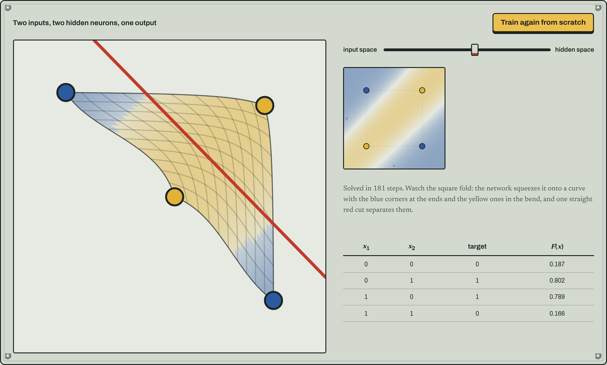

# How to Train Your Perceptron

An interactive explainer for the simplest neural network there is, built around the one problem it can't solve.

**[Open the live page →](https://liiiaamm.github.io/how-to-train-your-perceptron/)**



## What you can do on the page

1. **Move a decision line by hand.** Drag the line, or turn the bias, the two weights and the threshold, and watch the AND and OR truth tables update. The weights are drawn as patch cables whose thickness follows their size.
2. **Watch gradient descent find it.** Start from random weights and see the line sweep into place while the loss curve drops.
3. **Hit the XOR wall.** Try to separate XOR with one line. You can't get past three out of four, and gradient descent gets stuck too.
4. **Bend the plane.** Train a 2-2-1 network live, then morph the input square into the hidden layer's space. The network folds the square so that one straight cut separates the classes.

Everything runs in the browser in plain JavaScript: forward pass, backpropagation and rendering, with no libraries apart from MathJax for the equations.

The visual language comes from Rosenblatt's 1958 Mark I Perceptron: enamel equipment panels, patch cables and plotting paper.

## The maths

[`theory.html`](theory.html) has the full derivation: the sigmoid and its derivative, the gradient of the squared loss for AND and OR, why XOR is not linearly separable, and backpropagation through a hidden layer. It corrects one point of the original report: the decision boundary for $F > 1/2$ is $u = 0$, not $u = 1/2$.

The original written report is in [`Paper.pdf`](Paper.pdf) (Spanish).

## Run locally

```bash
python -m http.server 8000
# open http://localhost:8000
```

## Files

| Path | What it is |
|---|---|
| `index.html` | The interactive page |
| `theory.html` | Full derivation |
| `static/perceptron.js` | Models, training loops and canvas rendering |
| `static/style.css` | Styles |
| `Paper.pdf` | Original report |

## Context

Built as a team project for the Numerical Methods course at Comillas ICAI (BSc in Mathematical Engineering and AI), then rebuilt as an interactive page.
